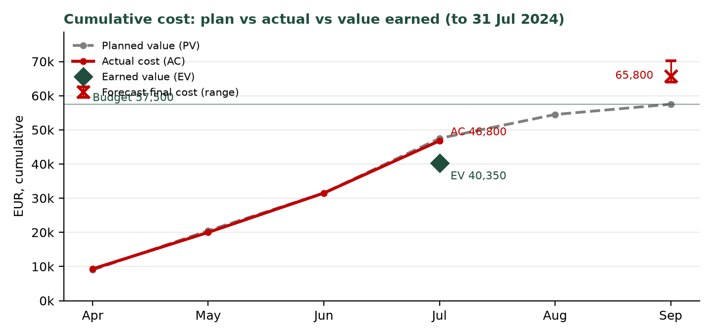
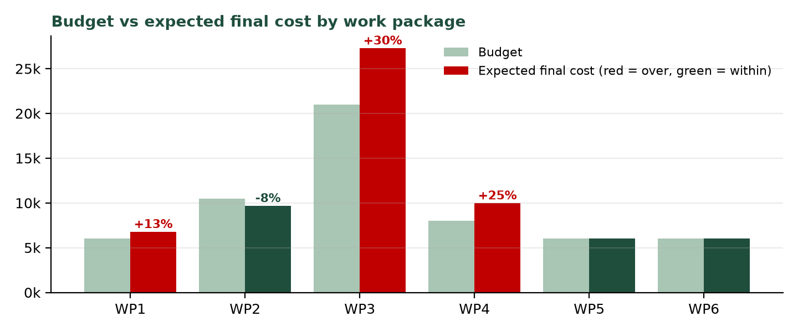

# Project cost control: Shopify migration (Earned Value Management)

[](https://github.com/mrfrog10/bergwerk-shopify-cost-control/actions/workflows/verify.yml)

A cost-control model and monthly status report for a fictional e-commerce
project. **BergWerk Outdoor GmbH** (Munich) is moving its outdoor-gear webshop
for Germany, Austria and Switzerland from WooCommerce to Shopify. The project
connects the shop to the JTL-Wawi inventory system, adds German payment methods
and launches with aftercare.

The Excel workbook is generated from Python. Every calculated figure is a live
formula, and the key results are named ranges (`CPI`, `EAC`,
`FORECAST_LAUNCH`, …). Changing an input (blue cell) updates the whole model.
Each build is recalculated in LibreOffice and checked three ways:

1. against the check figures in the project brief;
2. against an **independent Python calculation** ([src/oracle.py](src/oracle.py)),
   for the base case *and* a different what-if scenario;
3. by **integrity checks** that must catch bad inputs. Negative tests prove
   they do.



## Result at the status date (31 Jul 2024, month 4 of 6)

| Status | Rating |
|---|---|
| Cost | 🔴 RED: over budget even after spending the remaining reserve |
| Schedule | 🟠 AMBER: about 15% behind plan |

| Measure | Formula | Result | Meaning |
|---|---|--:|---|
| CPI | EV ÷ AC = 40,350 ÷ 46,800 | **0.86** | Each euro spent delivers 86 cents of planned work |
| SPI | EV ÷ PV = 40,350 ÷ 47,500 | **0.85** | About 15% behind plan |
| Cost so far vs planned | 46,800 − 47,500 | **−700** | Looks fine on the surface, which is why earned value is needed |
| Expected final cost (EAC) | AC + ETC | **65,800** | vs budget 57,500 (+8,300) |
| Overrun after reserve | 65,800 − 57,500 − 2,500 | **+5,800** | 9.7% of the EUR 60,000 total |
| Launch date | earned schedule | **29 Aug 2024** | about 2 weeks after the planned 15 Aug |

**The forecast is more likely to rise than fall.** Reaching 65,800 needs a
cost efficiency (TCPI) of 0.90 on the remaining work, but only 0.86 has been
achieved so far. Other forecasting methods give **63,950 to 70,216**.
Finishing within budget would need a TCPI of 1.60, which is not realistic.



**Main differences from budget:** WP3 integrations +30% (JTL-Wawi API rework),
WP4 data migration +25% (late start, duplicate product codes, broken umlauts),
WP1 discovery +13% (extra GDPR and Impressum workshops).

The full report is in [report/](report/) as a
[PDF](report/BergWerk_Monthly_Cost_Report_2024-07.pdf) and in
[Markdown](report/BergWerk_Monthly_Cost_Report_2024-07.md). Both are generated
from the recalculated workbook.

## What is in the workbook

[excel/BergWerk_Shopify_Cost_Control.xlsx](excel/BergWerk_Shopify_Cost_Control.xlsx)

| Sheet | Contents |
|---|---|
| Dashboard | Cost and schedule RAG status, key figures, auto-ranked variances, two charts |
| Settings | Dates, status date, hourly rate, contract budget, RAG thresholds |
| Budget | Work packages, approved CRs, reserve, reconciliation to contract value |
| PlannedValue | Original plan + CR phasing (pulled from the change log) = revised baseline |
| ActualCost | Monthly actuals with explanations; only months up to the status date count |
| ChangeLog | CRs with status, funding source and phasing month; flags approved CRs with no phasing |
| Commitments | Ordered but not yet invoiced costs (EUR 4,000) |
| EarnedValue | % complete (validated 0–100%), EV, CV, SV, CPI and SPI per work package |
| Forecast | AC + ETC = EAC, overrun after reserve, forecast range, TCPI |
| Schedule | Earned schedule and forecast launch date |
| Checks | A: brief check figures (12, all PASS). B: model integrity (8, all PASS) |
| RisksDecisions | Top 3 risks, a watch item, and 4 decisions with recommendations |

Blue cells on a cream background are inputs. Everything else is a formula.

## Method notes

- **Budget after CR-01:** the extra design round (EUR 1,500) moves from the
  reserve to WP2, so the work-package budget is 57,500 and the reserve is
  2,500. The total stays at 60,000.
- **Client-funded changes** (for example CR-02 Klarna, if approved) raise the
  contract value instead of using the reserve. The budget still reconciles.
- **Revised baseline:** an approved CR is phased into the month given in the
  change log, so PV to the end of July is 47,500 (not the original 46,000).
- **Pending changes** are tracked but kept out of the baseline and forecast.
- **Committed costs** are part of the estimate to complete. A check confirms
  each work package's ETC covers its commitments.
- **Launch forecast** uses earned schedule. EV of 40,350 sits 3.55 months into
  the plan after 4 months of actual time. The lag of 0.45 months × 31 days =
  14 days, so 15 Aug becomes 29 Aug. This assumes the lag does not grow;
  testing (WP5) is at SPI 0.60, so the date is at risk.

## Red-team review: weaknesses found and fixed

| # | Weakness in the first version | Fix |
|---|---|---|
| 1 | The report read fixed cell positions (`B15`), so a layout change would silently report wrong numbers | Key results are named ranges, and the report reads only those |
| 2 | The model was only checked against one set of numbers typed in by the same author | Independent Python oracle plus a second what-if scenario (CR-02 approved, status 31 Aug) |
| 3 | No proof the integrity checks work | Negative test feeds bad inputs and asserts each check fails |
| 4 | The earned schedule formula errored if EV was below month 1 or above the full plan | Edge cases handled |
| 5 | The forecast launch could be a date in the past | Never earlier than the day after the status date |
| 6 | Explanations were typed in and would go stale ("0.45 months × 31 days", "Month 4 of 6", "4,000 committed") | Built from formulas or named values |
| 7 | "Main differences" were in a fixed order | Ranked automatically by size of overrun |
| 8 | Approving a client-paid CR broke the budget check (total fixed at 60,000) | Contract value = original + client-funded CRs |
| 9 | Single-point forecast that hid how optimistic it was | Four-method EAC range and TCPI, with a note when the bottom-up EAC needs better efficiency than achieved |
| 10 | Inputs not checked: % complete over 100%, ETC below commitments, reserve overdrawn, approved CR with no phasing month | Data validation and eight integrity checks |
| 11 | Recommended billing BergWerk for a third party's (JTL) API defects without checking the contract | Recommendation now depends on the contract's scope assumptions and a defect log |
| 12 | The reserve would be fully used, but this was not raised | Added as a watch item |
| 13 | No CI; LibreOffice could clash with a running copy | GitHub Actions rebuilds and tests on every push; isolated LibreOffice profile |

## How to rebuild

Requirements: Python 3.10+ and LibreOffice (for recalculation, tests and the
report).

```bash
pip install -r requirements.txt
python run_all.py        # build workbook -> recalculate and verify -> build report
python -m pytest -q      # oracle, what-if and negative tests
```

The committed workbook stores formulas, and Excel, LibreOffice and Google
Sheets calculate them on opening. A copy with stored values is written to
`build/` by the verification step.

## Skills shown

Earned value management (PV, EV, AC, CPI, SPI, EAC, VAC, TCPI, earned
schedule) · baseline and change control · reserve management · forecasting
with commitments and ranges · RAG status reporting · Excel modelling with
named ranges, validation, conditional formatting and charts · Python
automation and testing (openpyxl, matplotlib, reportlab, pytest) · CI with
GitHub Actions.

---

*The client and all figures are made up for a portfolio case study.*
