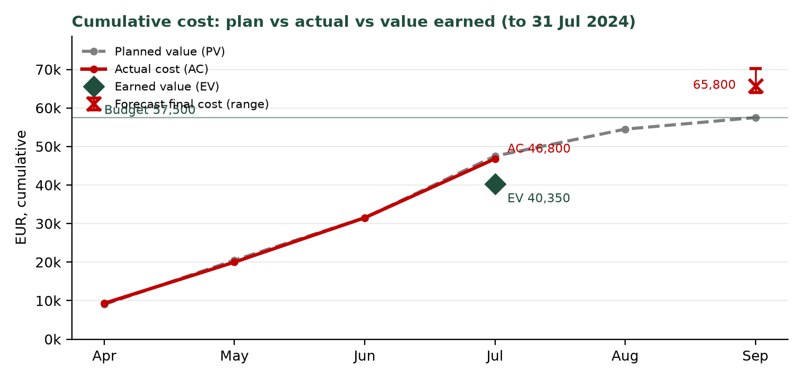
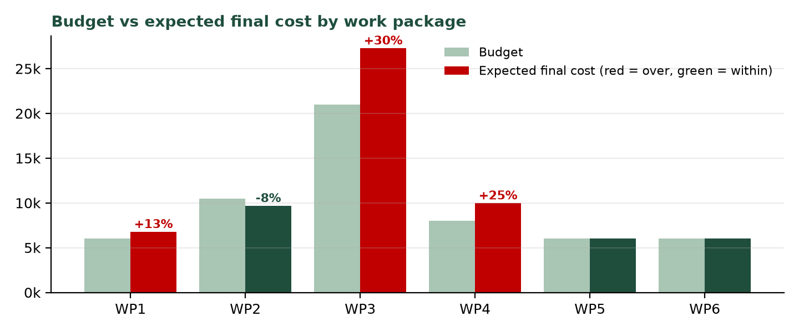

# Monthly cost report: BergWerk Outdoor Shopify migration

**Status date:** 31 Jul 2024 (month 4 of 6) · **Client:** BergWerk Outdoor GmbH, Munich (fictional) · all figures in EUR

| Cost | Schedule |
|---|---|
| 🔴 **RED** | 🟠 **AMBER** |

## Summary

Spending looks on plan: actual cost of 46,800 is 700 below the planned 47,500. Earned value shows a different picture. Only 40,350 of planned work is done, so each euro spent has delivered 86 cents of work (CPI 0.86) and the project is about 15% behind plan (SPI 0.85). The bottom-up forecast is 65,800 against a work-package budget of 57,500 (+8,300). After the remaining reserve of 2,500 is spent, the project is still 5,800 over its EUR 60,000 budget.

## Earned value by work package

| WP | Budget | % done | EV | PV | AC | CPI | SPI | EAC | EAC − budget |
|---|--:|--:|--:|--:|--:|--:|--:|--:|--:|
| WP1 Discovery and requirements | 6,000 | 100% | 6,000 | 6,000 | 6,800 | 0.88 | 1.00 | 6,800 | +800 (+13%) |
| WP2 Design | 10,500 | 100% | 10,500 | 10,500 | 9,700 | 1.08 | 1.00 | 9,700 | -800 (-8%) |
| WP3 Development and integrations | 21,000 | 85% | 17,850 | 21,000 | 22,800 | 0.78 | 0.85 | 27,300 | +6,300 (+30%) |
| WP4 Data migration | 8,000 | 60% | 4,800 | 8,000 | 6,500 | 0.74 | 0.60 | 10,000 | +2,000 (+25%) |
| WP5 Testing and quality checks | 6,000 | 20% | 1,200 | 2,000 | 1,000 | 1.20 | 0.60 | 6,000 | 0 |
| WP6 Launch, aftercare and training | 6,000 | 0% | 0 | 0 | 0 | n/a | n/a | 6,000 | 0 |
| **Total** | **57,500** | | **40,350** | **47,500** | **46,800** | **0.86** | **0.85** | **65,800** | **+8,300** |

## Main differences from budget

- **WP3 Development and integrations (+30%), +6,300:** Problems with the JTL-Wawi API caused rework on the inventory integration.
- **WP4 Data migration (+25%), +2,000:** Migration started late; duplicate product codes and broken umlauts needed cleaning.
- **WP1 Discovery and requirements (+13%), +800:** Extra workshops for the German legal requirements (GDPR, Impressum).
- **WP2 Design (-8%), -800:** Under budget: the CR-01 design round cost less than approved.

## How reliable is the forecast?

| Method | EAC | Overrun after reserve |
|---|--:|--:|
| Optimistic: remaining work costs as planned | 63,950 | +3,950 |
| Bottom-up team estimates (reported) | 65,800 | +5,800 |
| Cost efficiency so far continues (BAC / CPI) | 66,691 | +6,691 |
| Cost and schedule pressure continue | 70,216 | +10,216 |

The forecast is more likely to rise than fall. Reaching 65,800 needs a cost efficiency of 0.90 on the remaining work, but only 0.86 has been achieved so far. Finishing within budget would need 1.60, which is not realistic. Other methods give 63,950 to 70,216.

Earned value equals the plan for month 3.55, after 4 months of work: a lag of 14 days. This moves the launch from 15 Aug 2024 to about 29 Aug 2024. It assumes the lag does not grow. Testing (WP5) is at SPI 0.60, so the new date is at risk. Aftercare follows the launch, so the project end moves from 30 Sep 2024 to about 10 Oct 2024.

## Top 3 risks and one watch item

1. More integration bugs are found during testing (WP5) (impact high, likelihood medium). *Response:* Dev lead: fix JTL-Wawi defects first; daily triage during WP5.
2. Data quality problems (duplicate product codes, broken umlauts) delay the launch (impact high, likelihood medium). *Response:* Migration lead: UTF-8 export, de-duplication script, test re-import before go-live.
3. BergWerk wants Klarna (CR-02) live before launch (impact medium, likelihood high). *Response:* PM: agree scope and date with BergWerk this week.
4. Watch: only EUR 2,500 of reserve is left; once it goes to WP3 there is no contingency for the last two months (impact high, likelihood high). *Response:* PM: any new issue needs a change order or a budget increase.

## Decisions needed from the project manager

1. **Approve CR-02 (Klarna) now, or move it to after launch** (EUR 2,500; proposed due 02 Aug). *Recommendation:* Move to after launch: keeps WP5 testing focused; BergWerk pays EUR 2,500 either way.
2. **Spend the remaining reserve on WP3** (EUR 2,500; proposed due 02 Aug). *Recommendation:* Approve: WP3 is the largest overrun, but this leaves no contingency.
3. **Ask BergWerk to pay for the extra integration work through a change order** (EUR 6,300; proposed due 09 Aug). *Recommendation:* First check the contract: if JTL-Wawi API defects are outside the agreed assumptions, raise a change order with the defect log as evidence; otherwise absorb the cost.
4. **Agree the new launch date with BergWerk** (29 Aug 2024; proposed due 02 Aug). *Recommendation:* Confirm the forecast launch date in writing and re-plan WP6 support.

Change requests: CR-01 (Extra design revision round, EUR 1,500 from the reserve, WP2) is approved; CR-02 (Add Klarna as a payment option, EUR 2,500 paid by BergWerk) is pending and is not in the baseline or the forecast.

Committed costs of 4,000 (ordered, not yet invoiced) are included in the forecast, not added on top.

## Check figures

| Measure | Model | Expected | Result |
|---|--:|--:|:-:|
| CPI (cost efficiency) | 0.86 | 0.86 | PASS |
| SPI (schedule progress) | 0.85 | 0.85 | PASS |
| Earned value (EV) | +40,350 | +40,350 | PASS |
| Planned value to date (PV) | +47,500 | +47,500 | PASS |
| Actual cost to date (AC) | +46,800 | +46,800 | PASS |
| Cost so far vs planned | -700 | -700 | PASS |
| Expected final cost (EAC) | +65,800 | +65,800 | PASS |
| Variance at completion (VAC) | +8,300 | +8,300 | PASS |
| Reserve remaining | +2,500 | +2,500 | PASS |
| Overrun after the reserve | +5,800 | +5,800 | PASS |
| Overrun as % of total budget | 0.097 | 0.097 | PASS |
| Forecast launch date | 29 Aug 2024 | 29 Aug 2024 | PASS |
| Forecast project end | 10 Oct 2024 | 10 Oct 2024 | PASS |
